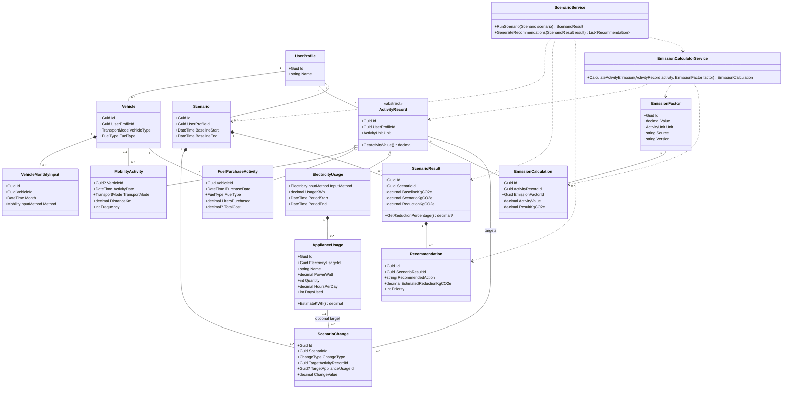

# VeloCarbon

**VeloCarbon** adalah aplikasi desktop berbasis **C# WPF** dengan arsitektur **MVVM** untuk membantu individu memahami, memantau, dan mengurangi jejak karbon dari mobilitas harian serta konsumsi listrik pribadi atau tempat tinggal (kos).

> VeloCarbon adalah alat edukasi berbasis estimasi; hasilnya bukan inventarisasi emisi resmi, audit karbon, atau dasar klaim sertifikasi.

## Informasi Proyek

| Elemen | Keterangan |
| --- | --- |
| Tema | Climate Action |
| Kategori | Pelacakan jejak karbon pribadi dan rekomendasi perubahan kebiasaan |
| Tipe aplikasi | Aplikasi desktop Windows |
| Teknologi utama | C#, .NET 8, WPF, MVVM, PostgreSQL, Entity Framework Core |
| Nama repository | `VeloCarbon` |

## Kelompok dan Tanggung Jawab

| Anggota | NIM/NIU | Peran | Tanggung jawab utama |
| --- | --- | --- | --- |
| Rafif Raihan Bahrul Alam | 24/534432/TK/59237 | Ketua Kelompok dan Frontend Developer | Antarmuka WPF, ViewModel, visualisasi tren dan hasil simulasi, pengalaman pengguna, serta dokumentasi penggunaan. |
| Faaid Sakhaa | 24/539398/TK/59820 | Software Architect | Arsitektur MVVM, model PBO, skema basis data dan ERD, kontrak antarmodul, standar Git, serta integrasi keseluruhan sistem. |
| Hendra Kurnia Maliqi | 24/542344/TK/60216 | Backend Developer | eksekusi ERD, develop API, menyusun method method API, integrasi backend frontend |

## Latar Belakang dan Permasalahan

Aktivitas sehari-hari seperti perjalanan menggunakan kendaraan pribadi dan penggunaan listrik menghasilkan emisi gas rumah kaca. Namun, pengguna sering tidak mengetahui sumber emisi terbesarnya maupun dampak dari perubahan kebiasaan sederhana. Informasi emisi tersebar dalam satuan yang sulit dibandingkan—liter bahan bakar, kilometer perjalanan, dan kWh listrik—sehingga pengguna tidak mempunyai dasar yang jelas untuk memilih aksi pengurangan emisi yang paling berdampak.

Kalkulator emisi sederhana umumnya hanya menampilkan total emisi sekali hitung. Pendekatan ini belum membantu pengguna menyimpan riwayat aktivitas, melihat tren, membandingkan skenario, dan memilih perubahan yang realistis.

## Solusi yang Diusulkan

VeloCarbon menyatukan catatan mobilitas harian dan konsumsi listrik dalam satu profil emisi pribadi. MVP mendukung **empat metode input** sesuai [PRD v0.3](docs/PRD-VeloCarbon.md):

1. **Perjalanan berbasis jarak** (`DistanceKm × Frequency`) untuk kendaraan pribadi maupun transportasi umum (jalan kaki, sepeda, bus, kereta, motor, mobil).
2. **Pembelian bahan bakar** (`LitersPurchased`, biaya opsional) untuk kendaraan pribadi.
3. **Listrik berdasarkan total kWh meter** (`UsageKWh`) untuk satu bulan kalender.
4. **Estimasi listrik berdasarkan alat elektronik** (`Σ Watt / 1000 × Jumlah × Jam/hari × Hari pakai`).

Aplikasi menghitung estimasi emisi CO2e menggunakan faktor emisi lokal yang memiliki sumber, versi, dan tanggal berlaku, menyimpan riwayat di PostgreSQL, lalu menjalankan simulasi perubahan kebiasaan beserta rekomendasi prioritas.

Contoh simulasi: pengguna membandingkan kondisi saat ini dengan pengurangan jarak perjalanan, liter pembelian bahan bakar, total kWh, atau jam pemakaian alat tertentu sebesar 10%. Aplikasi menampilkan emisi kondisi awal, emisi skenario, nilai dan persentase pengurangan pada bulan baseline, serta rekomendasi yang diprioritaskan berdasarkan estimasi dampaknya.

```text
Emisi aktivitas (kgCO2e) = nilai aktivitas x faktor emisi (kgCO2e per satuan)
Total emisi periode = jumlah emisi seluruh aktivitas pada periode tersebut
Pengurangan skenario = emisi kondisi awal - emisi skenario
```

Satuan aktivitas disesuaikan dengan kategorinya: `Km` untuk jarak perjalanan, `Liter` untuk bahan bakar, dan `KWh` untuk listrik. Faktor emisi disimpan di basis data bersama sumber, satuan, versi, dan masa berlaku agar perhitungan dapat ditelusuri dan diperbarui tanpa menimpa versi lama.

## Fitur Utama

1. **Profil emisi pribadi**: menyimpan profil pengguna, daftar kendaraan, dan preferensi satuan.
2. **Pencatatan mobilitas (jarak & bahan bakar)**: mencatat perjalanan berdasarkan jarak × frekuensi atau pembelian bahan bakar berdasarkan liter; sistem mencegah penghitungan ganda (satu metode per kendaraan per bulan).
3. **Pencatatan konsumsi listrik**: memasukkan total kWh meter atau menghitung estimasi dari rincian nama alat, watt, jumlah perangkat, jam per hari, serta hari pemakaian (satu catatan listrik per profil per bulan).
4. **Manajemen faktor emisi berversi**: menyimpan faktor emisi, sumber, satuan, versi, dan masa berlaku; pembaruan membuat versi baru.
5. **Perhitungan emisi CO2e**: menghitung emisi per aktivitas, kategori, dan periode secara atomik.
6. **Dashboard dan tren**: menampilkan total emisi bulanan, sumber terbesar, kontribusi per kategori, serta tren 6 bulan.
7. **Simulasi skenario**: membandingkan kondisi dasar dengan pengurangan jarak, liter bahan bakar, total kWh, atau jam pemakaian alat tanpa mengubah catatan asli.
8. **Rekomendasi aksi**: memberi saran perubahan kebiasaan yang diurutkan berdasarkan estimasi pengurangan emisi terbesar.
9. **Penyimpanan PostgreSQL & Web API pendamping**: menyimpan seluruh data di PostgreSQL melalui EF Core, dilengkapi layanan Web API + Swagger opsional untuk kalkulator cepat (`/api/estimate`) dan integrasi eksternal.

## Batasan Ruang Lingkup MVP

- Sasaran pengguna adalah **individu**, bukan organisasi atau rumah tangga dengan banyak penghuni.
- Kategori yang dihitung pada versi awal hanya mobilitas darat dan listrik pribadi/kos.
- Faktor emisi digunakan sebagai estimasi edukatif dan wajib mencantumkan sumber.
- Pembelian bahan bakar merupakan pendekatan estimasi, bukan pengukuran bahan bakar yang terbakar pada bulan tersebut. Estimasi alat mengasumsikan daya rata-rata selama jam pemakaian.
- Laporan dan baseline memakai bulan kalender. Satu kendaraan memakai satu metode mobilitas per bulan (`Distance` atau `FuelPurchase`) dan satu profil memakai satu metode listrik per bulan (`MeterKWh` atau `ApplianceEstimate`) agar sumber yang sama tidak dihitung dua kali.
- Perpindahan moda otomatis, proyeksi tahunan, dan integrasi cuaca belum termasuk MVP.

## Aplikasi Sejenis dan Perbedaan

| Aplikasi sejenis | Fokus umum | Perbedaan VeloCarbon |
| --- | --- | --- |
| [CarbonFootprint.com Calculator](https://www.carbonfootprint.com/calculator.aspx) | Perhitungan emisi rumah, perjalanan, dan gaya hidup berbasis kuesioner | VeloCarbon menyimpan aktivitas periodik, menampilkan tren, dan membandingkan skenario perubahan kebiasaan. |
| [JouleBug](https://joulebug.com/) | Pelacakan aksi dan tantangan kebiasaan berkelanjutan | VeloCarbon berfokus pada kalkulasi CO2e pribadi yang dapat ditelusuri melalui faktor emisi berversi. |
| [Giki Zero](https://giki.earth/giki-zero-your-step-by-step-guide-to-a-sustainable-life/) | Estimasi jejak karbon pribadi dan saran langkah pengurangan | VeloCarbon membatasi MVP pada mobilitas darat dan listrik, menyimpan riwayat aktivitas, serta menyediakan simulasi skenario lokal. |

## Arsitektur Ringkas

VeloCarbon menerapkan pemisahan lapisan **MVVM + Clean Architecture** agar antarmuka desktop, logika domain, layanan API, dan penyimpanan data tidak saling bergantung secara langsung.

```text
WPF Views (VeloCarbon.App) <-> ViewModels --+
                                            +--> Application & Domain Services (VeloCarbon.Core)
Web API / Swagger (VeloCarbon.Api, opsional)+         |
                                                      +--> EF Core Repositories (VeloCarbon.Infrastructure) <-> PostgreSQL
```

Struktur solution (`VeloCarbon.sln`):

- `src/VeloCarbon.Core` — model domain, enum, aturan validasi, kalkulator emisi, dan mesin skenario.
- `src/VeloCarbon.Infrastructure` — `VeloCarbonDbContext`, migrasi EF Core PostgreSQL (11 tabel TPH), repository, dan seeder faktor/data demo.
- `src/VeloCarbon.App` — aplikasi desktop Windows WPF (MVVM).
- `src/VeloCarbon.Api` — layanan Web API + Swagger UI (pendamping opsional).
- `tests/VeloCarbon.Tests` — unit test domain & tes integrasi PostgreSQL.

Model domain inti: `UserProfile`, `Vehicle`, `VehicleMonthlyInput`, `ActivityRecord`, `MobilityActivity`, `FuelPurchaseActivity`, `ElectricityUsage`, `ApplianceUsage`, `EmissionFactor`, `EmissionCalculation`, `Scenario`, `ScenarioChange`, `ScenarioResult`, dan `Recommendation`.

### Class Diagram

Diagram menampilkan kelas dan atribut yang menentukan kontrak empat metode input. `<<abstract>>` menunjukkan kelas abstrak; panah segitiga mengarah ke induk, diamond menunjukkan kepemilikan siklus hidup, dan garis putus-putus menunjukkan penggunaan oleh service.



## Referensi Awal

1. Intergovernmental Panel on Climate Change (IPCC), [*2006 IPCC Guidelines for National Greenhouse Gas Inventories*](https://www.ipcc-nggip.iges.or.jp/public/2006gl/) dan pembaruannya.
2. Kementerian Lingkungan Hidup dan Kehutanan Republik Indonesia, dokumen faktor emisi dan inventarisasi gas rumah kaca yang berlaku.
3. Kementerian Energi dan Sumber Daya Mineral Republik Indonesia / PT PLN (Persero), publikasi bauran dan faktor emisi kelistrikan.

## Menjalankan Demo & Pengujian

Prasyarat pengembang: **.NET SDK 8** (Windows untuk menjalankan WPF) dan **PostgreSQL 16** (atau Docker Desktop).

```powershell
# 1. Jalankan PostgreSQL lokal via Docker (atau gunakan PostgreSQL terpasang + deploy/package/setup-database.sql)
docker compose -f deploy/docker-compose.yml up -d

# 2. Build solution dan jalankan unit test (44 unit test; +4 tes integrasi bila VELOCARBON_TEST_DB disetel)
dotnet build VeloCarbon.sln
dotnet test VeloCarbon.sln

# 3. Jalankan aplikasi desktop WPF (migrasi & seed data demo otomatis saat pertama kali dibuka)
dotnet run --project src/VeloCarbon.App

# 4. (Opsional) Jalankan Web API + Swagger UI di http://localhost:5080/swagger
dotnet run --project src/VeloCarbon.Api

# 5. (Opsional) Bangun paket rilis Windows self-contained ZIP
.\deploy\build-release.ps1
```

## Dokumentasi Terkait

- [PRD VeloCarbon (v0.3)](docs/PRD-VeloCarbon.md) — kebutuhan fungsional/nonfungsional, rumus, dan diagram acuan.
- [Keputusan Baseline & Penyelarasan Skema DB](docs/KEPUTUSAN-BASELINE.md) — keputusan arsitektur MVP (#11) dan ERD aktual 11 tabel EF Core vs PR #10.
- [Panduan Instalasi & Konfigurasi](docs/INSTALASI.md) — instalasi paket rilis Windows, opsi PostgreSQL, dan pemecahan masalah.
- [Panduan Pengguna](docs/PANDUAN-PENGGUNA.md) — panduan cepat 5 menit, empat metode input, dan simulasi.
- [Dokumentasi Web API](docs/API.md) — daftar endpoint REST, Swagger UI, dan contoh `curl`.

## Kontribusi dan Alur Git

1. Setiap anggota bekerja pada branch yang menggunakan NIU/NIM masing-masing.
2. Setiap perubahan dibuat melalui commit dengan pesan yang jelas.
3. Sebelum menggabungkan perubahan ke `main`, anggota membuat Pull Request untuk ditinjau anggota lain.
4. Branch anggota tidak dihapus setelah Pull Request digabungkan, sesuai ketentuan Modul 1.

Contoh branch Software Architect: `539398`.
