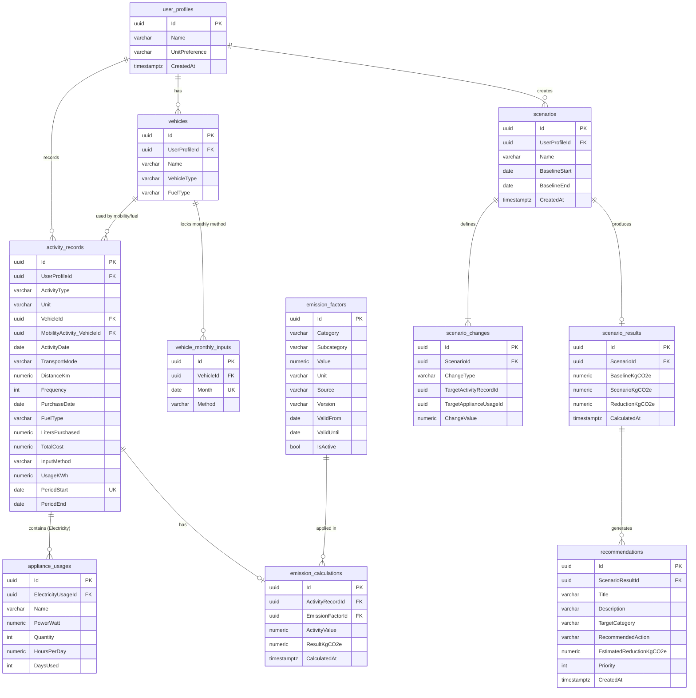

# Keputusan Baseline MVP & Penyelarasan Skema Basis Data (Issue #11)

Dokumen ini mencatat keputusan arsitektur baseline MVP VeloCarbon di branch `main`, inventarisasi perbaikan lintas branch, serta penyelarasan antara rancangan ERD pada PR #10 (`origin/539398`) dan migrasi EF Core aktual.

## 1. Keputusan Baseline Tim

| Aspek | Keputusan Final | Alasan & Referensi |
| --- | --- | --- |
| **Antarmuka Desktop** | **WPF (.NET 8, MVVM)** — `src/VeloCarbon.App` | Sesuai PRD v0.3 dan paket yang sudah didemokan (`origin/542344` + modernisasi UI pada PR #19). Menghindari pemeliharaan dua UI desktop sekaligus (WinForms pada `origin/534432` tidak digabungkan). |
| **Lingkup Metode Input** | **4 Metode Input sesuai PRD v0.3** | 1) Perjalanan berbasis jarak (`DistanceKm × Frequency`), 2) Pembelian bahan bakar (`LitersPurchased`), 3) Listrik meter (`UsageKWh`), 4) Estimasi listrik alat elektronik (`Σ Watt/1000 × Qty × Jam × Hari`). |
| **Peran Web API** | **Layanan pendamping opsional** — `src/VeloCarbon.Api` | WPF mengakses `VeloCarbon.Core` dan `VeloCarbon.Infrastructure` secara lokal tanpa wajib menjalankan server HTTP saat demo; Web API tetap disertakan di solution dan paket rilis untuk Swagger (`/swagger`), kalkulator cepat (`POST /api/estimate`), dan integrasi eksternal. |
| **Basis Data & ORM** | **PostgreSQL 16 + EF Core 8** — `src/VeloCarbon.Infrastructure` | Migrasi otomatis (`InitialCreate`) dan seed idempoten dijalankan saat aplikasi/API mulai, sesuai `docs/INSTALASI.md`. |
| **Kebersihan Repo** | **Hapus prototipe `frontend/` (Next.js mock)** | Prototipe web mock tidak termasuk lingkup MVP desktop Windows dan tidak terhubung ke backend. |

## 2. Inventarisasi Branch & Perbaikan yang Dibawa

| Branch | Ringkasan Isi | Status di `main` |
| --- | --- | --- |
| `origin/542344` + PR #19 (`codex/velocarbon-branding`) | Solusi WPF 4 metode, `VeloCarbon.Core`, `VeloCarbon.Infrastructure`, `VeloCarbon.Api`, `VeloCarbon.Tests` (48 test), dokumentasi instalasi/pengguna/API, dan UI dashboard modern. | **Baseline utama di `main`** (tergabung via PR #19). |
| `origin/534432` | Alternatif WinForms + Web API (3 metode input), `.gitattributes`, skrip packaging PowerShell (`scripts/package.ps1`), serta uji API end-to-end. | **Tidak membawa UI WinForms.** Perbaikan yang diadopsi ke `main`: 1. `.gitattributes` (memaksa CRLF untuk `.bat`/`.ps1` dan LF untuk `.sh`). 2. `deploy/build-release.ps1` (skrip packaging Windows native PowerShell + checksum SHA256). *(Uji HTTP end-to-end dicatat untuk dituntaskan pada Issue #15 & #16.)* |
| `origin/539398` (PR #10, closed) | Rancangan ERD konseptual 14 tabel (`database/schema.sql`, `docs/database/erd.md`, `data-dictionary.md`). | **Diselaraskan di dokumen ini** terhadap migrasi aktual EF Core (11 tabel, lihat bagian 3). |

## 3. Penyelarasan Skema Basis Data: PR #10 vs Migrasi Aktual EF Core

Migrasi aktual pada `src/VeloCarbon.Infrastructure/Persistence/Migrations/20261122101133_InitialCreate.cs` (dikonfigurasi di `VeloCarbonDbContext.cs`) menggunakan pola **Table-Per-Hierarchy (TPH)** dengan **11 tabel** PostgreSQL, sedangkan rancangan fisik pada PR #10 menggunakan pola **Table-Per-Type (TPT)** dengan **14 tabel**.

### Perbandingan Kunci

| Aspek | Rancangan PR #10 (`origin/539398`) | Implementasi Aktual EF Core (`main`) | Catatan & Alasan |
| --- | --- | --- | --- |
| **Inheritance `ActivityRecord`** | **TPT (4 tabel):** `activity_record`, `mobility_activity`, `fuel_purchase_activity`, `electricity_usage` | **TPH (1 tabel):** `activity_records` dengan discriminator `ActivityType` (`Mobility`, `FuelPurchase`, `Electricity`) | TPH menyederhanakan query riwayat & dashboard tanpa banyak `LEFT JOIN`, tetap menjaga constraint `ck_mobility_positive` dan unique index listrik per profil per bulan. |
| **Penamaan tabel & kolom** | Tabel singular `snake_case`, kolom `snake_case` | Tabel plural `snake_case` (`user_profiles`, `activity_records`, dst.), kolom `PascalCase` default EF Core | Mengikuti konvensi `VeloCarbonDbContext.cs`; migrasi EF Core menjadi sumber kebenaran (*single source of truth*). |
| **Relasi `scenario_changes` → `activity_records`** | Foreign Key (`ON DELETE RESTRICT`) | **Snapshot ID tanpa FK** (`TargetActivityRecordId`, `TargetApplianceUsageId`) | Disengaja agar riwayat hasil skenario tetap utuh apabila pengguna menghapus aktivitas asli di kemudian hari. |
| **Periode Listrik & Pengurangan Skenario** | `period_end` diturunkan; `reduction_kg_co2e` generated column | Disimpan eksplisit pada kolom `PeriodEnd` dan `ReductionKgCO2e` | Memudahkan pembacaan langsung dari EF Core & pelaporan tanpa fungsi database tambahan. |
| **Validasi Bisnis** | Check constraint + trigger tertunda SQL | Kombinasi check constraint/unique index DB + validasi domain di `ActivityService`, `ScenarioService`, `EmissionFactorService` | Aturan inti diuji oleh 44 unit test dan 4 tes integrasi PostgreSQL. |

### ERD Aktual (`main` — 11 Tabel PostgreSQL)

### Constraint & Indeks Penting di Migrasi Aktual

- `IX_vehicle_monthly_inputs_VehicleId_Month` (**UNIQUE**): menjamin satu kendaraan hanya memakai satu metode (`Distance` atau `FuelPurchase`) per bulan.
- `IX_activity_records_UserProfileId_PeriodStart` (**UNIQUE**): menjamin maksimal satu catatan listrik per profil per bulan.
- `IX_emission_calculations_ActivityRecordId` (**UNIQUE**): menjamin satu hasil perhitungan emisi per aktivitas.
- `IX_scenario_results_ScenarioId` (**UNIQUE**): menjamin satu hasil aktif per skenario.
- `ck_mobility_positive`: menjamin `DistanceKm > 0` dan `Frequency >= 1` untuk baris bertipe `Mobility`.
- `ck_factor_nonneg`: menjamin nilai `EmissionFactor.Value >= 0`.
