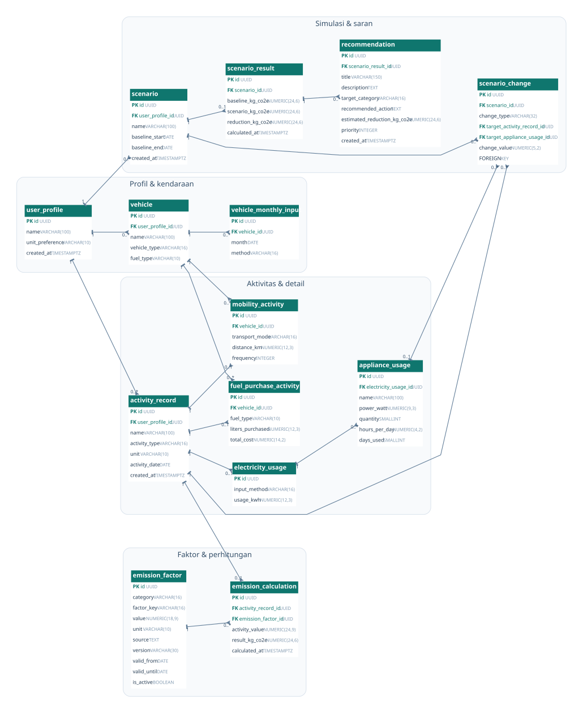

# ERD Basis Data VeloCarbon

Format [PNG untuk dikumpulkan](erd.png), [DOT yang bisa diedit](erd.dot), [kamus data 84 atribut](data-dictionary.md), dan [skema PostgreSQL](../../database/schema.sql).

## Entitas

ERD mencakup 14 tabel untuk profil dan kendaraan, catatan perjalanan/bahan bakar/listrik, faktor emisi dan perhitungannya, serta simulasi dan rekomendasi. Tabel `activity_record` menyimpan data umum; detail tiap jenis aktivitas menggunakan ID induk sebagai PK dan FK. Tanggal awal periode listrik tersimpan di induk; tanggal akhir diturunkan.

## Relasi dan kardinalitas

`1` = wajib satu, `0..1` = opsional satu, `0..*` = nol atau banyak.

| Relasi | Kardinalitas | Penjelasan |
| --- | --- | --- |
| `user_profile` → `vehicle` | 1 : 0..* | Profil mengelola kendaraan. |
| `user_profile` → `activity_record` | 1 : 0..* | Profil mencatat aktivitas. |
| `user_profile` → `scenario` | 1 : 0..* | Profil membuat skenario. |
| `vehicle` → `vehicle_monthly_input` | 1 : 0..* | Kendaraan mempunyai satu pilihan metode per bulan. |
| `vehicle` → `mobility_activity` | 1 : 0..* | Kendaraan opsional untuk moda Bus. |
| `vehicle` → `fuel_purchase_activity` | 1 : 0..* | Kendaraan terkait pembelian bahan bakar. |
| `activity_record` → `mobility_activity` | 1 : 0..1 | PK dan FK bersama; tepat satu subtype wajib. |
| `activity_record` → `fuel_purchase_activity` | 1 : 0..1 | PK dan FK bersama; tepat satu subtype wajib. |
| `activity_record` → `electricity_usage` | 1 : 0..1 | PK dan FK bersama; tepat satu subtype wajib. |
| `electricity_usage` → `appliance_usage` | 1 : 0..* | Rincian untuk metode Appliances. |
| `activity_record` → `emission_calculation` | 1 : 0..1 | Maksimal satu hasil per aktivitas. |
| `emission_factor` → `emission_calculation` | 1 : 0..* | Faktor digunakan ulang. |
| `scenario` → `scenario_change` | 1 : 0..* | Perubahan; minimal satu divalidasi service. |
| `activity_record` → `scenario_change` | 1 : 0..* | Perubahan menarget aktivitas baseline. |
| `appliance_usage` → `scenario_change` | 0..1 : 0..* | Alat opsional untuk perubahan jam. |
| `scenario` → `scenario_result` | 1 : 0..1 | Satu hasil terbaru. |
| `scenario_result` → `recommendation` | 1 : 0..* | Prioritas unik per hasil. |

## Aturan desain

Satu aktivitas harus memiliki tepat satu detail sesuai `activity_type`. Trigger tertunda memeriksa aturan ini di akhir transaksi. Nilai faktor dan hasil perhitungan disimpan bersama agar emisi lama dapat ditelusuri. Faktor baru ditambahkan sebagai versi baru; backend memeriksa satuan, kategori, tanggal berlaku, dan sumber.

Per kendaraan hanya ada satu konfigurasi metode mobilitas per bulan. Per profil hanya satu catatan listrik per bulan. Unique constraint/index mencegah catatan ganda; backend wajib menyimpan pilihan metode dan aktivitas secara transaksional serta memeriksa kesesuaian pemilik kendaraan, tanggal, metode, faktor dan aktivitas baseline. Meter menyimpan total kWh, sementara metode Appliances menyimpan detail alat dan total kWh dihitung dengan rumus `watt ÷ 1000 × jumlah × jam × hari`.

Satu skenario menggunakan satu bulan kalender dan menyimpan hasil terbaru. FK gabungan mengikat alat sasaran ke aktivitas listriknya. Backend memeriksa minimal satu perubahan, kecocokan tipe perubahan dengan aktivitas, kepemilikan, dan persentase 0–100. Kamus data menjelaskan seluruh tipe, ukuran, batas nilai, dan kunci.
